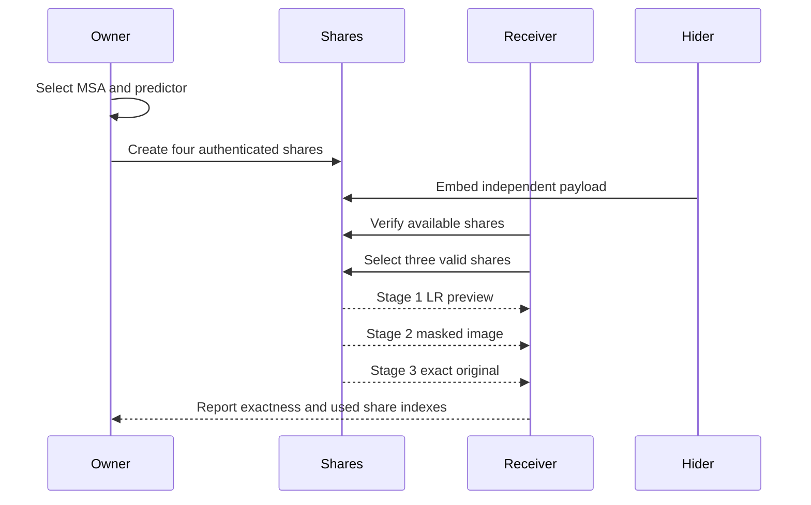

# Progressive Secret Image Sharing (PSS-DRDHEI)

A reproducible, research-oriented implementation of **progressive secret image sharing with reversible data hiding in encrypted images**, inspired by the PSS-DRDHEI paper.

> **Important academic note:** this repository is a **simplified reproduction plus project extensions**. It does not claim to reproduce the paper's RCAN and GICA neural components exactly. The substitutions and extensions are documented in [`SPEC.md`](SPEC.md) and [`DEVIATIONS.md`](DEVIATIONS.md).

## At a glance

| Item | Current implementation |
|---|---|
| Threshold scheme | `(r, n) = (3, 4)` over GF(2⁸) |
| Image format | 8-bit grayscale, normalized to 512 × 512 |
| Progressive outputs | LR preview, masked image, exact original |
| Sensitive region | Manual, texture-adaptive, or edge-adaptive MSA rectangle |
| Predictors | Bilinear, edge-directed, MED, RCAN-style fixed-point ablation, and automatic best-predictor selection |
| Inpainting backends | Telea baseline and deterministic contextual multi-scale fallback |
| Data hiding | Independent payload embedding with CRC validation |
| Integrity | Keyed BLAKE2s share tags and invalid-share rejection |
| Resilience extension | Masked/original recovery from any three valid shares |
| Interfaces | FastAPI + React/Vite dashboard and Streamlit fallback |
| Evaluation | E1–E18 CSV experiments and generated reports on eight bundled images |

## Why this project matters

The project addresses a practical security problem: how to split a sensitive image into multiple noise-like shares while allowing different recovery levels depending on the number of available shares and keys.

The implementation demonstrates three progressive states:

1. **Stage 1:** any three valid shares recover a low-resolution preview.
2. **Stage 2:** any three valid shares recover the full masked image.
3. **Stage 3:** any three valid shares recover the exact original when the protected MSA payload and required key are available.

The project then extends the baseline with content-aware protection, compression-aware prediction, and recovery after one damaged or missing share.

## Research contribution

### Baseline reproduction

- MSA extraction and protected storage.
- Telea inpainting as a deterministic baseline, plus a contextual multi-scale GICA-inspired fallback.
- 2×2 low-resolution sampling.
- Integer prediction and residual coding.
- Huffman compression.
- GF(2⁸) threshold sharing.
- Redundant-pixel expansion and embedding.
- Independent data-hider payload extraction.
- Exact progressive recovery.

### Project extensions

1. **Adaptive MSA selection**
   - `manual`: use the selected rectangle.
   - `auto_texture`: select the highest local-variance window.
   - `auto_edge`: select the strongest Sobel-gradient window.

2. **Automatic predictor selection**
   - Evaluate bilinear, edge-directed, and MED.
   - Select the shortest compressed residual stream.
   - Report the candidate bit lengths and mean absolute residuals.

3. **Paper-aligned fidelity track**
   - `contextual` inpainting provides deterministic coarse-to-fine context propagation and
     Navier–Stokes refinement as a stronger GICA-inspired fallback.
   - `rcan_style` provides fixed-point residual refinement as an RCAN-style predictor ablation.
   - Both modes preserve exact recovery because sender and receiver use the same deterministic
     implementation and retain the residual losslessly.

4. **Tamper-aware resilient recovery**
   - Verify every share before recovery.
   - Exclude invalid or unavailable shares.
   - Recover from the first valid three-share subset.
   - Reject recovery when fewer than three valid shares remain.

## System architecture

```mermaid
flowchart LR
    A[Owner uploads image] --> B[MSA selection]
    B --> C[Mask sensitive region]
    C --> D[Low-resolution image]
    D --> E[Predictor selection]
    E --> F[Residual + Huffman coding]
    F --> G[GF(2^8) threshold sharing]
    G --> H[Redundant-pixel expansion]
    H --> I[Four authenticated shares]
    I --> J[Data-hider payload]
    I --> K[Integrity verification]
    K --> L[Progressive recovery]
    L --> M[Stage 1: LR preview]
    L --> N[Stage 2: masked image]
    L --> O[Stage 3: exact original]
```

## Progressive recovery flow



## Repository layout

```text
pss/                 Core algorithm implementation
  msa.py             MSA preparation, restoration, adaptive selection
  inpainting.py      Telea and contextual multi-scale inpainting
  deep_models.py     RCAN-style fixed-point predictor metadata/backend
  predictor.py       Bilinear, edge-directed, MED, bicubic, RCAN-style predictors
  pipeline.py        Owner encoding and progressive recovery
  sharing.py         GF(2⁸) pair sharing and reconstruction
  embed.py           Share expansion, headers, data hiding
  auth.py            Keyed share integrity verification
api/                 FastAPI adapter used by the React dashboard
web/                 React/Vite/TypeScript research dashboard
experiments/         Reproducible E1–E18 experiment runner
tests/               Unit, integration, tamper, image, and extension tests
data/images/         Eight documented public sample substitutes
results/             CSV outputs and run metadata
figures/             Generated experiment figures
SPEC.md              Paper-inspired implementation specification
DEVIATIONS.md        Explicit differences from the paper
TESTING.md           Full automated, UI, and experiment testing guide
```

## Quick start

### Python environment

```bash
python -m venv .venv
source .venv/bin/activate       # Windows: .venv\Scripts\activate
python -m pip install -e ".[test]"
```

### Run the complete test suite

```bash
python -m pytest -q
```

### Run a CLI demonstration

```bash
python -m pss.cli demo \
  --image data/images/sailboat.png \
  --rect 300 300 60 40 \
  --seed 123 \
  --method auto \
  --out demo_out
```

The CLI prints the selected predictor and exact recovery checks. Expected output includes:

```text
Stage 2 exact: True
Stage 3 exact: True
```

### Run the Streamlit fallback

```bash
streamlit run app.py
```

### Run the React research dashboard

Terminal 1, from the repository root:

```bash
python -m uvicorn api.main:app --reload --port 8000
```

Terminal 2:

```bash
cd web
npm install
npm run dev
```

Open the URL printed by Vite, normally:

```text
http://127.0.0.1:5173
```

The dashboard flow is:

```text
Owner → Data hider → Receiver → Analysis → Research Summary
```

The Research Summary view is designed for a professor-facing demonstration. It explains the baseline, the three extensions, the current predictor decision, MSA coordinates, capacity, integrity state, and exact-recovery evidence.

## Running the experiments

Run the full reproducible experiment suite:

```bash
python experiments/run_all.py
```

The runner writes:

| Output | Purpose |
|---|---|
| `E1.csv` | Exact progressive recovery and share combinations |
| `E2.csv` | Practical embedding-rate comparison |
| `E3.csv` | Security metrics for generated shares |
| `E4_overview.png` | Visual pipeline overview |
| `E5.csv` | Wrong-key rejection and exact recovery |
| `E6.csv` | Runtime measurements |
| `E7.csv` | MSA size/capacity sweep |
| `E8.csv` | Predictor and residual-compression comparison |
| `E9.csv` | Ramp-leakage analysis |
| `E10.csv` | Data-hider capacity and round-trip test |
| `E11.csv` | Keyed tamper detection |
| `E12.csv` | Manual versus adaptive MSA selection |
| `E13.csv` | One-tampered-share and one-missing-share recovery |
| `E14.csv` | Automatic predictor-selection evidence |
| `E15.csv` | All four three-share threshold combinations |
| `E16.csv` | Recovery and data-hider attack matrix |
| `E17.csv` | Final baseline-versus-extension evaluation |
| `E18.csv` | Telea/contextual and integer/RCAN-style fidelity comparison |
| `final_report.md` | Generated presentation report |
| `final_manifest.json` | Seeds, backends, experiment coverage, and verification flags |
| `run_metadata.json` | Seeds, image provenance, methods, and experiment metadata |

The eight bundled images are documented in [`data/README.md`](data/README.md). They are public sample substitutes, not the exact images from the paper.

## How to discuss the results

The strongest claims supported by the implementation are:

- Exact Stage 1, Stage 2, and Stage 3 recovery is verified by array equality.
- Every three-share threshold combination is tested.
- One invalid or unavailable share can be excluded while recovery remains exact.
- Two invalid or unavailable shares leave fewer than three valid shares and are rejected.
- Adaptive MSA placement is reproducible and remains inside the image.
- Automatic predictor selection is based on measured compressed residual length.
- The contextual inpainting and RCAN-style predictor backends are deterministic and preserve exact Stage 3 recovery.
- Data-hider payloads are independently extracted and CRC-validated.

Do not claim that the project reproduces RCAN or GICA exactly, or that the measured security metrics prove cryptographic security. Present those components as documented simplifications and interpret entropy, correlation, NPCR, and UACI as empirical measurements of generated shares.

## Limitations and honest scope

- The original trained RCAN and GICA weights are not bundled. The default path remains the
  deterministic integer/Telea baseline; optional `rcan_style` and `contextual` modes are
  reproducible architecture-inspired ablations, not exact neural-network reproduction claims.
- The eight images are public sample substitutes.
- The original paper's comparison schemes are quoted where noted; they are not reimplemented.
- The automatic MSA selector is a reproducible heuristic based on local texture or edges.
- The automatic predictor selector optimizes the compressed residual stream, not perceptual quality.
- The `(3,4)` code/MSA threshold recovery is a project extension and is documented separately from the paper-inspired baseline.

See [`DEVIATIONS.md`](DEVIATIONS.md) for the full decision record.

## Interface design direction

The primary dashboard uses a visual research-workspace language inspired by modern interactive
learning products: a floating rounded navigation bar, warm paper background, serif editorial
headings, restrained navy/cream controls, and a large visual work area for the image and MSA
selection. The styling is intentionally adapted to this project rather than copied from another
product; the research workflow and evidence remain the focus.

The visual hierarchy is designed for a live professor demonstration:

1. The hero explains the project in one sentence.
2. The Owner workspace makes the image and sensitive-region selection the focal interaction.
3. The workflow navigation keeps Data hider, Receiver, Analysis, and Summary one click away.
4. The Summary view presents quality metrics, the key-permission ladder, paper comparison, and
   attack evidence without requiring the evaluator to inspect source code.

## Documentation map

- [`SPEC.md`](SPEC.md) — paper-inspired algorithm and implementation specification.
- [`TESTING.md`](TESTING.md) — exact commands for unit tests, UI checks, API checks, and E1–E18 experiments.
- [`FINAL_REPORT.md`](FINAL_REPORT.md) — generated baseline-versus-extension summary for presentation.
- [`DEVIATIONS.md`](DEVIATIONS.md) — differences from the paper and project-extension decisions.
- [`data/README.md`](data/README.md) — image provenance and substitute-image mapping.

## Current verification status

The current implementation has been verified with:

```text
Python test suite: 38 passed
React/Vite production build: successful
Targeted E18 fidelity experiment: generated successfully
E18 optional-backend checks: Stage 3 exact and deterministic for all tested rows
Existing E1–E17 results and final report: retained and documented
```

The frontend build may print a non-blocking Vite bundle-size advisory; it does not prevent the dashboard from running.
